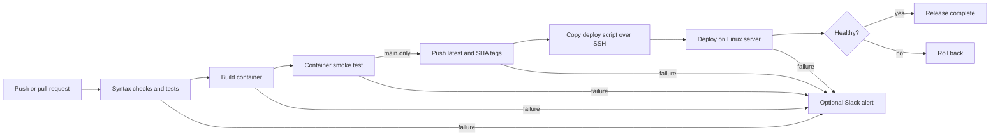

# AutoDeploy

AutoDeploy is a small, production-minded DevOps project that tests a Node.js API, builds it as a Docker image, publishes the image to Docker Hub, and deploys it to a Linux server after every successful push to `main`.

The deployment uses an immutable commit-SHA image, waits for the container health check, and automatically restores the previous image if the new release is unhealthy.

The root URL serves a live operations dashboard for demonstrating application health, runtime details, response latency, and the automated delivery workflow. See the [presentation guide](docs/PRESENTATION_GUIDE.md) for a professor-ready walkthrough.

## Pipeline



Pull requests run tests and build the container but cannot publish or deploy. By default, pushes to `main` also run this secret-free CI path. The publish and deploy jobs become active only when the repository variable `ENABLE_DEPLOYMENT` is set to `true`.

## Included features

- Express API with `/health` and `/ready` probes
- Unit/API tests using Node's built-in test runner and Supertest
- Multi-stage, non-root Docker image with a built-in health check
- GitHub Actions test, container smoke-test, publish, and deploy jobs
- Docker Hub tags for `latest` and the full Git commit SHA
- SSH deployment to a Docker-enabled Linux server
- Automatic rollback to the previously running image
- Optional Slack failure notifications
- Dependency caching, Docker layer caching, SBOM, and build provenance

## Project structure

```text
.
|-- .github/workflows/ci-cd.yml  # CI/CD pipeline
|-- scripts/
|   |-- deploy.sh                # Health-checked deploy and rollback
|   `-- setup-server.sh          # Debian/Ubuntu Docker setup helper
|-- src/
|   |-- app.js                   # Express application
|   `-- server.js                # HTTP server and graceful shutdown
|-- public/                      # Live demonstration dashboard
|-- docs/PRESENTATION_GUIDE.md  # Demo script, use case, and viva notes
|-- test/app.test.js             # API tests
|-- Dockerfile
|-- compose.yaml
`-- package.json
```

## Run locally

Requirements: Node.js 22+ and npm.

```bash
npm ci
npm test
npm start
```

Open <http://localhost:3000>. Useful endpoints are:

| Endpoint | Purpose |
| --- | --- |
| `GET /` | Live operations dashboard |
| `GET /api` | Application and deployed-version metadata |
| `GET /api/info` | Runtime and environment information |
| `GET /api/metrics` | Live process uptime, memory, and request count |
| `GET /health` | Liveness/health probe |
| `GET /ready` | Readiness probe |

Run it with Docker instead:

```bash
docker compose up --build
curl http://localhost:3000/health
```

Stop the local stack with `docker compose down`.

## Configure continuous deployment

Continuous integration requires no secrets: push the project to GitHub and the test and container smoke-test jobs will run automatically. Docker Hub publishing and Linux deployment are optional. To activate them, complete the configuration below and add the repository variable `ENABLE_DEPLOYMENT=true` only after all required secrets exist.

### 1. Create the external resources

1. Create a GitHub repository and push this project to a `main` branch.
2. Create a Docker Hub repository named `autodeploy` under your Docker Hub account.
3. Prepare a Debian/Ubuntu server reachable from the GitHub-hosted runners over SSH.
4. Point a firewall/security-group rule at the application port (port `3000` by default). Restrict SSH as tightly as your environment allows.

The server needs Docker and a non-root deployment user with permission to run it. From a checked-out copy on the server, this helper installs the Ubuntu/Debian `docker.io` package:

```bash
sudo sh scripts/setup-server.sh YOUR_DEPLOY_USER
```

Sign out and back in after the script changes group membership. Membership in the `docker` group effectively grants root-level control, so use a dedicated deployment account.

### 2. Add GitHub secrets and variables

In **Repository settings → Secrets and variables → Actions**, add:

| Name | Type | Required | Value |
| --- | --- | --- | --- |
| `DOCKERHUB_USERNAME` | Secret | Yes | Docker Hub username |
| `DOCKERHUB_TOKEN` | Secret | Yes | Docker Hub access token, not the account password |
| `SERVER_HOST` | Secret | Yes | Server hostname or public IP |
| `SERVER_USER` | Secret | Yes | Linux deployment user |
| `SERVER_SSH_KEY` | Secret | Yes | Private SSH key for the deployment user |
| `SERVER_SSH_PORT` | Secret | No | SSH port; defaults to `22` |
| `SLACK_WEBHOOK_URL` | Secret | No | Slack incoming-webhook URL for failure alerts |
| `APP_PORT` | Variable | No | Public application port; defaults to `3000` |
| `ENABLE_DEPLOYMENT` | Variable | Yes for CD | Set to `true` only when Docker Hub and server secrets are ready |

For safer releases, create a GitHub environment named `production`, move the server secrets into it, and add required reviewers. The deploy job already targets that environment.

### 3. Push to `main`

The workflow will:

1. Install locked dependencies, check syntax, and run tests with coverage.
2. Build the image and start a temporary container for a real HTTP health check.
3. Publish `<username>/autodeploy:latest` and `<username>/autodeploy:sha-<full-commit-sha>`.
4. Copy `scripts/deploy.sh` to the server and launch the SHA-tagged image.
5. Wait up to 60 seconds for Docker to report the new container healthy.
6. Restore the previous image and fail the workflow if health checks do not pass.

GitHub also sends its standard workflow notifications. If `SLACK_WEBHOOK_URL` is configured, the final job posts the failed commit and workflow link to Slack.

## Run a deployment manually

On the server, authenticate to Docker Hub and run:

```bash
sh scripts/deploy.sh YOUR_DOCKERHUB_USERNAME/autodeploy:sha-COMMIT_SHA autodeploy 3000
```

The script intentionally performs a stop-and-replace deployment, so expect a short interruption. A reverse proxy plus blue/green containers would be the natural next step for zero-downtime releases.

## Add an honest resume metric

Do not invent a percentage. Measure the same release manually and through GitHub Actions:

1. Record the time from starting a manual test/build/push/deploy to a healthy response.
2. Record the Actions run duration from push to a healthy deployment.
3. Calculate `(manual minutes - automated minutes) / manual minutes × 100`.
4. Repeat at least three times and use the median.

Example wording after measurement: “Reduced median deployment lead time from **X** minutes to **Y** minutes (**Z%**) by automating tests, image publishing, health verification, and rollback.”

## Useful checks

```bash
npm run check
npm run test:coverage
docker build --tag autodeploy:local .
docker inspect --format '{{.State.Health.Status}}' autodeploy
docker logs autodeploy
```

## License

This project is available under the [MIT License](LICENSE).
